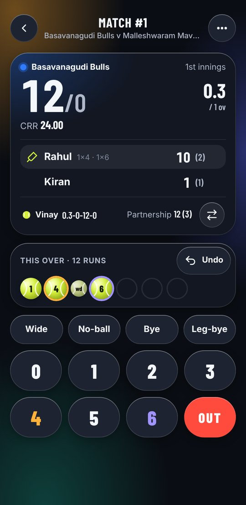
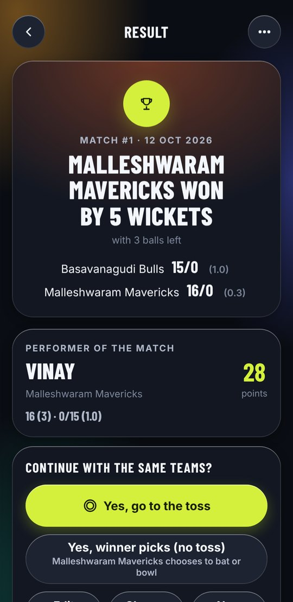
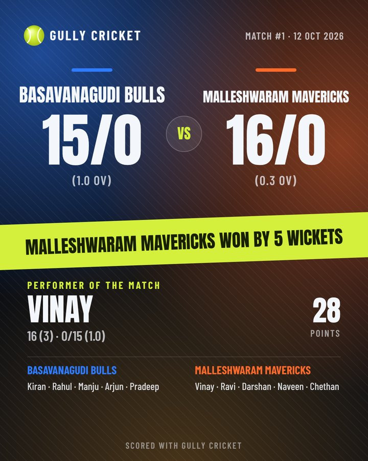

# Gully Cricket

Score street cricket ball by ball, with your own gully rules. An offline Android app in English and ಕನ್ನಡ.

<p align="center">
  
  
  
</p>

## Download

**[Get the latest APK](../../releases/latest)**. The app is not on Google Play; you install it directly.

1. Open the latest release and tap **GullyCricket-x.y.z.apk** under *Assets*.
2. Open the downloaded file. If Android asks, allow **Install unknown apps** for your browser or Files app.
3. If Play Protect says the developer is unknown, tap **More details → Install anyway**.

Needs Android 8.0 or newer. New versions install over the old one and keep your matches.

### ಕನ್ನಡದಲ್ಲಿ

**[ಹೊಸ APK ಡೌನ್‌ಲೋಡ್ ಮಾಡಿ](../../releases/latest)**. ಈ ಆ್ಯಪ್ Google Play ನಲ್ಲಿ ಇಲ್ಲ; ನೇರವಾಗಿ ಇನ್‌ಸ್ಟಾಲ್ ಮಾಡಿ.

1. ಹೊಸ release ತೆರೆದು *Assets* ನಲ್ಲಿ **GullyCricket-x.y.z.apk** ಒತ್ತಿ.
2. ಡೌನ್‌ಲೋಡ್ ಆದ ಫೈಲ್ ತೆರೆಯಿರಿ. ಕೇಳಿದರೆ **Install unknown apps** ಅನುಮತಿ ನೀಡಿ.
3. Play Protect ಎಚ್ಚರಿಕೆ ಬಂದರೆ **More details → Install anyway** ಒತ್ತಿ.

## What it does

- **Teams once, reused forever.** Save squads, add a common player who bats for both sides.
- **Your gully rules.** Last batter bats alone, single batter, six is out, re-bowl wides, free hit, retire at N runs, bowler over limits, plus house rules like one tip one hand.
- **Toss.** Flip the in-app coin or enter a real coin, or let the last match's winner pick bat or bowl.
- **One tap per ball.** Big run keys, wide / no-ball / bye pills, undo anything. The over shows as tennis balls; a wicket is the red tape ball.
- **Wickets the gully way.** Bowled, caught, stumped or run out, then pick the next batter. No fielder names.
- **Ties settled.** Super over, share the match, or a bowl-out.
- **Performer of the match** from batting and bowling impact, plus a full scorecard.
- **Result poster** in a bold sports style: share it to WhatsApp or save it to your gallery.
- **Kannada and English**, light and dark themes, a Solid look for bright sun.

## Privacy

The app has no internet permission, no ads and no accounts. Teams and matches stay on your phone. Use **Settings → Backup** to save a backup file or move matches to another phone.

## Build it yourself

```bash
node build.js            # builds the web app into android/app/src/main/assets/www
node test/engine.test.js # rules engine tests
cd android && gradle assembleRelease   # Gradle 8.10, JDK 17, Android SDK 35
```

Or open the `android/` folder in Android Studio.

Pushing a tag such as `v1.0.1` runs the **Build Android APK** workflow, which builds the APK and attaches it to a GitHub release. Release builds are signed with the key stored in the repository secrets `ANDROID_KEYSTORE_BASE64`, `ANDROID_KEYSTORE_PASSWORD`, `ANDROID_KEY_ALIAS` and `ANDROID_KEY_PASSWORD`. Without them the workflow signs with a debug key and marks the release as a pre-release.

## Project layout

| Path | What it is |
| --- | --- |
| `src/engine.js` | Rules engine: event-sourced, every ball is an event, undo replays the log |
| `src/app.js`, `src/styles.css`, `src/i18n.js` | Screens, glass + pill styling, English and Kannada strings |
| `android/` | WebView shell: share, save to gallery, back button, keep screen on |
| `test/` | Engine unit tests and browser tests |
| `fonts/` | Anton, Barlow Condensed, Noto Sans Kannada (SIL Open Font License 1.1) |
